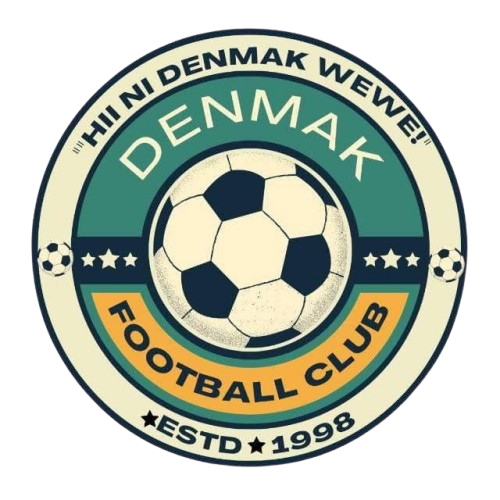

# Denmak FC Maganyakulo - Official Website



The official digital headquarters for **Denmak FC Maganyakulo**, a football club based in Maganyakulo, Matuga Constituency, Kwale County, Kenya. Competing in the FKF Division Two Northern Zone League (Pool A).

This project serves four main audiences simultaneously: **Supporters, Players, Sponsors, and the Media.**

---

## 📖 Table of Contents

- [About the Project](#-about-the-project)
- [Key Features](#-key-features)
- [Tech Stack](#-tech-stack)
- [Project Structure](#-project-structure)
- [Getting Started](#-getting-started)
- [How to Update Matches & Scores](#-how-to-update-matches--scores)
- [Future Roadmap (Admin Dashboard)](#-future-roadmap-admin-dashboard)
- [Contact & Social Media](#-contact--social-media)
- [License](#-license)

---

## 🌟 About the Project

This website was built to transform Denmak FC from a local community team into a nationally recognized brand. It serves as a central hub for:

- **Match Centre:** Live league standings, upcoming fixtures, and recent results.
- **Squad Profiles:** Detailed information on players, technical staff, and club legends.
- **History & Heritage:** The club's journey from 1998 to national parliamentary recognition.
- **Revenue & Partnerships:** Information for sponsors and an online merchandise store.
- **Latest News:** Updates, match reports, and media highlights.

---

## ✨ Key Features

- **📱 Fully Responsive Design:** Optimized for mobile phones, which is how the majority of supporters access the site.
- **⚽ Dynamic Match Centre:** Displays league tables, fixtures, and results powered by `data/matches.js`.
- **📰 News Hub:** Dedicated section for club news, with direct links to YouTube highlights and Facebook posts.
- **🤝 Sponsorship Portal:** Detailed packages, branding locations, and verified audience stats for potential partners.
- **🛒 Online Store (MVP):** A frontend merchandise shop ready for WhatsApp and M-Pesa order placement.
- **📜 Club History:** A visual timeline highlighting key milestones, including parliamentary recognition.
- **🔍 SEO Optimized:** Structured data (JSON-LD) for SportsTeam, Organization, and Website to help Google and AI understand the club.
- **⚡ Offline / Local Preview Ready:** Works immediately when double-clicking files locally with zero CORS restrictions.

---

## 🛠️ Tech Stack

This project is currently built as a **lightweight static frontend website**:

- **HTML5:** Semantic structure and SEO meta tags.
- **CSS3:** Custom styling, CSS Variables, Flexbox, and Grid. No external frameworks (like Bootstrap) for maximum performance.
- **JavaScript (Vanilla):** Interactivity, hamburger menu, carousel logic, and dynamic data rendering.
- **Data Engine:** Decoupled data model (`data/matches.js` and `data/matches.json`).

### Planned Backend Stack (For Admin Dashboard)
To allow club officials to update content without touching code, the following stack is planned:
- **Backend:** Node.js + Express.js
- **Database:** MongoDB (via Mongoose)
- **Authentication:** JSON Web Tokens (JWT)
- **Deployment:** Netlify / Vercel (Frontend) + Render / Railway (Backend)

---

## 📁 Project Structure

```text
denmak-fc/
│
├── index.html              # Homepage (Hero, Next Match, News, Partners)
├── matches.html            # Match Centre (League Table, Fixtures, Results)
├── squad.html              # Squad (Goalkeepers, Defenders, Midfielders, Forwards)
├── history.html            # History (Timeline, Legends Corner, Management)
├── revenue.html            # Revenue Hub (Store & Partnerships overview)
├── store.html              # Online Store (Merchandise & Cart)
├── partnerships.html       # Sponsorship Packages & Opportunities
├── robots.txt              # Search engine crawler instructions
├── sitemap.xml             # XML sitemap for SEO indexing
│
├── data/                   # Dynamic match data engine
│   ├── matches.js          # Offline-ready client data (works on double-click)
│   └── matches.json        # Standard JSON data (for server and API fetch)
│
├── pages/                  # Secondary Pages
│   ├── news.html           # Latest News Feed
│   ├── privacy.html        # Privacy Policy
│   ├── terms.html          # Terms of Service
│   └── sitemap.html        # Site Map
│
├── css/
│   └── style.css           # Main Stylesheet
│
├── js/
│   └── script.js           # Main JavaScript (Carousel, Cart, Match Loader)
│
└── images/                 # All club logos, player photos, and sponsor banners
```

---

## 🚀 Getting Started

No build tools, bundlers, or package installations are needed to run this project.

### Option 1: Direct Local Preview (Double-Click)
1. Clone or download this repository.
2. Navigate to the project directory on your computer.
3. Double-click `index.html` or `matches.html`.
4. The site opens instantly in your default web browser.

### Option 2: Run with VS Code Live Server
1. Open the project folder in **Visual Studio Code**.
2. Install the **Live Server** extension if you haven't already.
3. Right-click `index.html` and select **"Open with Live Server"**.
4. The site will run on `http://127.0.0.1:5500/`.

---

## 🔄 How to Update Matches & Scores

To update upcoming games, scores, or league standings, you **do not** need to edit `index.html` or `matches.html`. 

Simply edit **`data/matches.js`** (and `data/matches.json`):

### 1. Change the Next Match (Homepage)
```javascript
"nextMatch": {
  "homeTeam": "Denmak FC",
  "awayTeam": "Black EaglesFC",
  "date": "October 18, 2026",
  "time": "3:00 PM EAT",
  "venue": "Kombani Ground, Kombani",
  "competition": "Rashid Abdallah Super Cup",
  "ticketInfo": "Free Entry / VIP KSh 200"
}
```

### 2. Add Recent Match Results
Insert the latest match at the top of the `"results"` list:
```javascript
{
  "date": "Oct 18, 2026",
  "opponent": "Black EaglesFC",
  "location": "H",
  "score": "2 - 1",
  "status": "W",
  "outcome": "win"
}
```

### 3. Update League Table & Points
Update Denmak FC's aggregate stats in `"league"` and update their row inside `"standings"`:
```javascript
{
  "rank": 1,
  "team": "Denmak FC",
  "played": 29,
  "won": 23,
  "drawn": 4,
  "lost": 2,
  "gd": "+37",
  "points": 73,
  "isClub": true
}
```

---

## 🗺️ Future Roadmap (Admin Dashboard)

- [ ] **Admin Authentication:** Secure login for club media managers.
- [ ] **Matchday Score Poster Generator:** Auto-export Instagram/Facebook graphics from match scores.
- [ ] **M-Pesa STK Push Integration:** One-click checkout for jerseys and merchandise in the store.
- [ ] **Player Profiles CMS:** Ability to add new player photos and bio updates without code edits.
- [ ] **Ticketing Module:** Digital ticket generation with QR codes for high-profile matches.

---

## 📍 Contact & Social Media

- **Home Ground:** Maganyakulo Ground, Matuga Constituency, Kwale County, Kenya
- **Email:** [fcdenmak@gmail.com](mailto:fcdenmak@gmail.com)
- **Phone:** +254 118 514 735
- **Facebook:** [Denmak FC Official](https://www.facebook.com/profile.php?id=100083734833393)
- **Instagram:** [@denmak_fc_maganyakulo](https://www.instagram.com/denmak_fc_maganyakulo)
- **YouTube:** [@DenmakFC](https://www.youtube.com/@DenmakFC)

---

## 📄 License

This project is licensed under the [MIT License](LICENSE) — see the LICENSE file for details.

© 2026 **Denmak FC Maganyakulo**. All rights reserved.
